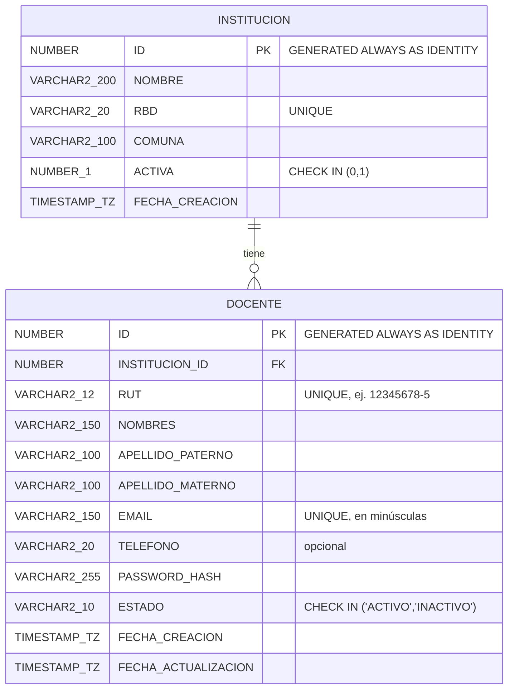

# Modelo de datos — Etapa 0 y Etapa 1

## Diagrama entidad-relación (tablas actuales)

Convenciones aplicadas (ver migración `alembic/versions/0002_docentes_instituciones.py`):

- Nombres de tablas y columnas en MAYÚSCULAS.
- `VARCHAR2` con largos explícitos.
- `ID` como `GENERATED ALWAYS AS IDENTITY`.
- Fechas como `TIMESTAMP WITH TIME ZONE`.
- `ACTIVA` como `NUMBER(1)` con `CHECK (ACTIVA IN (0,1))` (compatible con Oracle 19c).
- Constraints con nombre explícito: `PK_INSTITUCION`, `PK_DOCENTE`, `UK_INSTITUCION_RBD`,
  `UK_DOCENTE_RUT`, `UK_DOCENTE_EMAIL`, `FK_DOCENTE_INSTITUCION`, `CK_INSTITUCION_ACTIVA`,
  `CK_DOCENTE_ESTADO`.
- Índice `IX_DOCENTE_INSTITUCION_ID` sobre `DOCENTE.INSTITUCION_ID`.

## Acceso a datos: paquetes PL/SQL

El acceso a datos de `INSTITUCION`/`DOCENTE` **no se hace con SQL generado por el
ORM**: la API llama a paquetes PL/SQL (migración
`alembic/versions/0003_paquetes_plsql.py`), que son los que concentran también las
validaciones de negocio.

- **`PKG_INSTITUCION`**
  - `listar_activas(p_cursor OUT SYS_REFCURSOR)` — instituciones con `ACTIVA = 1`.
  - `esta_activa(p_id) RETURN NUMBER` — `1`/`0` según `ACTIVA`, o `-1` si no existe
    (la usa `PKG_DOCENTE` para validar la institución al crear/actualizar).
- **`PKG_DOCENTE`**
  - `insertar(...)` — valida institución (existe y activa), RUT y email únicos; inserta
    y devuelve el `ID` nuevo.
  - `actualizar(...)` — los parámetros `NULL` significan "no cambiar ese campo";
    revalida institución/email solo si cambian.
  - `cambiar_estado(p_id, p_estado)` — actualiza `ESTADO` y `FECHA_ACTUALIZACION`.
  - `obtener(p_id, p_cursor OUT SYS_REFCURSOR)`.
  - `listar(..., p_cursor OUT SYS_REFCURSOR, p_total OUT NUMBER)` — paginación con
    `OFFSET`/`FETCH NEXT` y búsqueda con `LIKE` sobre nombres/apellidos/RUT.

Las validaciones usan `RAISE_APPLICATION_ERROR` con códigos fijos, que
`app/db/oracle_calls.py` traduce a las excepciones de dominio (y por lo tanto a los
códigos HTTP) de la API:

| Código Oracle | Significado | Excepción / HTTP |
| --- | --- | --- |
| `-20001` | La institución indicada no existe | `RecursoNoEncontradoError` → `404` |
| `-20002` | La institución indicada no está activa | `ValidacionNegocioError` → `422` |
| `-20003` | El RUT ya está registrado | `ConflictoError` → `409` |
| `-20004` | El correo ya está registrado | `ConflictoError` → `409` |
| `-20005` | El docente no existe | `RecursoNoEncontradoError` → `404` |

El hash de la contraseña (Argon2) sigue haciéndose en Python antes de llamar a
`PKG_DOCENTE.insertar`, porque PL/SQL no tiene una implementación nativa de Argon2.

## Trazabilidad endpoint ↔ requisito

| Endpoint | Requisito que cubre | Reglas de negocio aplicadas | Códigos de respuesta |
| --- | --- | --- | --- |
| `POST /api/v1/docentes` | Registrar un docente | RUT válido (módulo 11) y normalizado; email válido, único y en minúsculas; contraseña ≥8 caracteres con letra y número (solo se guarda el hash Argon2); institución debe existir y estar activa; nombres normalizados | `201` creado · `404` institución inexistente · `409` RUT o email duplicado · `422` validación |
| `GET /api/v1/docentes` | Listar, con paginación y filtros por `institucion_id`, `estado` y búsqueda por nombre o RUT | Paginación `page`/`size` (máx. 100 por página); búsqueda parcial case-insensitive por nombres, apellidos o RUT | `200` ok · `422` parámetros inválidos |
| `GET /api/v1/docentes/{id}` | Obtener un docente | — | `200` ok · `404` no existe |
| `PATCH /api/v1/docentes/{id}` | Actualizar datos (sin cambiar la contraseña) | No permite modificar `rut` ni `password`; si cambia `email`, se revalida unicidad; si cambia `institucion_id`, se revalida que exista y esté activa; nombres normalizados | `200` ok · `404` docente o institución inexistente · `409` email duplicado · `422` validación |
| `PATCH /api/v1/docentes/{id}/estado` | Activar o desactivar (eliminación lógica) | Nunca se hace `DELETE` físico; solo cambia `ESTADO` y `FECHA_ACTUALIZACION` | `200` ok · `404` no existe · `422` validación |
| `GET /api/v1/instituciones` | Listar instituciones para poder elegir una al registrar | Solo lectura; devuelve únicamente instituciones activas (son las únicas seleccionables al registrar un docente) | `200` ok |

## Limitaciones conocidas de esta etapa

- La búsqueda por nombre (`busqueda`) es case-insensitive pero **no ignora tildes**
  (p. ej. buscar `perez` no encuentra `Pérez`); Oracle `UPPER()` no pliega acentos sin
  configuración adicional de NLS, que queda fuera del alcance de esta etapa.
- La capitalización de nombres usa `str.title()` (una heurística simple); no reconoce
  partículas como "de la"/"del" para dejarlas en minúscula en apellidos compuestos.
